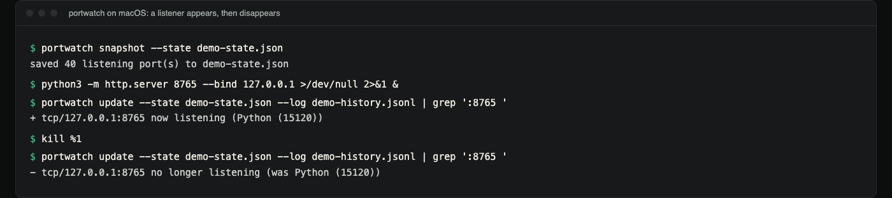
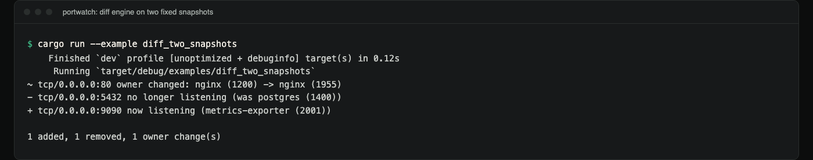

# portwatch

Inventory listening TCP/UDP ports and the processes that own them, and
report exactly what changed since the last snapshot.

**Status:** version 0.1.0, a small CLI and library. Linux, macOS and Windows
backends, tested in CI on all three. Not published to crates.io: the
`portwatch` crate there is an unrelated TUI, so install from a clone.

```bash
git clone https://github.com/hellpuffyt/portwatch && cd portwatch
cargo install --path .            # needs Rust 1.87 or newer
```

```bash
portwatch snapshot                # today: saves portwatch-state.json
# ... a week later ...
portwatch diff                    # what moved?
```

## Demo



*Real capture on macOS: a baseline, then a local HTTP server appears and
disappears. Other processes on this machine open short-lived listeners all
the time, so the `update` output is filtered to the demo port with `grep`;
`update` still saved the full snapshot and logged every change.*



*`cargo run --example diff_two_snapshots`: the diff engine on two snapshots
built in code, with no live system access.*

The same sessions as text:

```console
$ portwatch snapshot --state demo-state.json
saved 40 listening port(s) to demo-state.json
$ python3 -m http.server 8765 --bind 127.0.0.1 >/dev/null 2>&1 &
$ portwatch update --state demo-state.json --log demo-history.jsonl | grep ':8765 '
+ tcp/127.0.0.1:8765 now listening (Python (15120))
$ kill %1
$ portwatch update --state demo-state.json --log demo-history.jsonl | grep ':8765 '
- tcp/127.0.0.1:8765 no longer listening (was Python (15120))
```

## Why this and not the 1000 `netstat` clones

`netstat`, `ss`, and `lsof -i` all answer "what is listening *right now*".
That's not the question that matters for a machine you don't watch every
hour: the useful finding is never "port 31337 is open", it's "**port
31337 was not open yesterday**", or "**nginx used to own port 443 and now
something else does**". Answering that means diffing two points in time,
which means a snapshot format, an identity rule for what counts as "the
same" listener across two scans, and a decision about what to do when a
port has more than one owner at once. That's the actual engineering here,
and it's what turns up real bugs the trivial version doesn't have to face
(see below).

Two decisions carry the design:

**A listener's identity is `(protocol, address, port)`, not its pid.**
Process ids get recycled on every restart. Key on the pid and a routine
`systemctl restart nginx` looks like a removal plus an addition. portwatch
keys on the socket, so a restart is a single, high-signal `OwnerChanged`
event naming the old and new pid. That is also what it looks like when
something *replaces* a service on a well-known port, the case this tool
actually exists to catch:

```text
~ tcp/0.0.0.0:443 owner changed: nginx (1200) -> nginx (1955)
```

**A port can have more than one simultaneous owner, and the diff has to
handle that correctly.** This one wasn't a design decision up front. It
was a bug I hit while dogfooding the first version on my own machine.
Windows was reporting the UDP mDNS port (`:5353`) as owned by two
different processes (`steamwebhelper.exe` and `brave.exe`, both bound
with `SO_REUSEADDR` the way multicast listeners commonly are), and my
first diff engine assumed one owner per port. Whichever process the OS
enumerated *second* silently overwrote the first in an internal map, so
between two back-to-back scans where literally nothing had changed, the
diff reported the port's owner flip-flopping between the two processes
purely from OS table-enumeration order. The fix (in
[`src/diff.rs`](src/diff.rs)) compares the full *set* of owners at each
key: a stable shared port produces no changes regardless of scan order,
a co-owner joining or leaving is `Added`/`Removed`, and only a clean
single-owner-to-single-owner handoff is reported as `OwnerChanged`. It's
covered by four tests built directly from that failure
(`src/diff.rs::tests`, search `shared`).

## Commands

```text
portwatch scan      [--json]                             print current listening ports
portwatch snapshot  [--state PATH] [--json]              capture and save a baseline
portwatch diff      [--state PATH] [--json]              compare live ports to the baseline
portwatch update    [--state PATH] [--log PATH] [--json] diff, log, then re-save the baseline
portwatch history   [--log PATH] [--json]                print previously logged changes
portwatch help | -h | --help                             print usage
portwatch -V | --version                                 print the version
```

| Flag | Effect |
| --- | --- |
| `--state PATH` | snapshot file to read/write (default `portwatch-state.json`) |
| `--log PATH` | append-only history log for `update`/`history` (default `portwatch-history.jsonl`) |
| `--json` | machine-readable JSON instead of a table/text report |

Exit codes are part of the interface:

| Code | Meaning |
| --- | --- |
| 0 | success; for `diff`/`update`, no changes were found |
| 1 | an error occurred (I/O, unsupported platform, missing or unreadable snapshot, unknown command or option) |
| 2 | success; for `diff`/`update`, at least one change was found |

That makes `diff`/`update` drop straight into a cron line or a CI step:
`portwatch update --state /var/lib/portwatch/state.json || alert-ops`.

## Real output

`portwatch scan` on the Windows machine where this README was first written
(121 rows in full; here are the first ten):

```text
PROTO  ADDRESS                    PORT   STATE   PROCESS
tcp    0.0.0.0                    135    LISTEN  svchost.exe (2380)
tcp    0.0.0.0                    445    LISTEN  System (4)
tcp    0.0.0.0                    2179   LISTEN  vmms.exe (3988)
tcp    0.0.0.0                    5040   LISTEN  svchost.exe (12152)
tcp    0.0.0.0                    7070   LISTEN  AnyDesk.exe (6416)
tcp    0.0.0.0                    7680   LISTEN  svchost.exe (24092)
tcp    0.0.0.0                    27036  LISTEN  steam.exe (13236)
tcp    0.0.0.0                    49664  LISTEN  lsass.exe (1904)
tcp    0.0.0.0                    49665  LISTEN  wininit.exe (2032)
tcp    0.0.0.0                    49666  LISTEN  svchost.exe (3332)
```

`cargo run --example diff_two_snapshots` builds two snapshots in code (no
live system access) and diffs them. Its stdout:

```text
~ tcp/0.0.0.0:80 owner changed: nginx (1200) -> nginx (1955)
- tcp/0.0.0.0:5432 no longer listening (was postgres (1400))
+ tcp/0.0.0.0:9090 now listening (metrics-exporter (2001))

1 added, 1 removed, 1 owner change(s)
```

## Platform support, honestly

One `PortSource` trait, three real backends, and no `netstat`-parsing
fallback pretending to be a syscall:

| | Linux | Windows | macOS |
| --- | --- | --- | --- |
| Mechanism | reads `/proc/net/{tcp,tcp6,udp,udp6}`, walks `/proc/<pid>/fd` for ownership | calls `GetExtendedTcpTable`/`GetExtendedUdpTable` (IP Helper API) directly via FFI, `CreateToolhelp32Snapshot` for names | runs `/usr/sbin/lsof +c 0 -nP -iTCP` / `-iUDP` and parses its columns |
| Sees all ports unprivileged | mostly: fd ownership needs matching uid or root | yes | no, only sockets the caller can see |
| IPv4-mapped IPv6 (`::ffff:127.0.0.1`) | parsed correctly | parsed correctly | parsed correctly |

Sharp edges, stated rather than hidden:

- **Linux:** a socket whose owning process you can't read `/proc/<pid>/fd`
  for (different user, no permission) is still reported, with `pid` and
  `process_name` left `null`, never silently dropped. This is exercised
  end-to-end by a test that scans a fixture `/proc` tree containing
  exactly that case (`src/linux.rs::full_scan_over_fixture_proc_tree_*`).
- **macOS:** `lsof` truncates `COMMAND` to 9 characters unless asked
  not to, and prints spaces in it as `\x20` (`Brave\x20Browser`).
  portwatch passes `+c 0` and decodes the escapes. The wildcard address
  is printed as `*` for both IPv4 and IPv6, so the `TYPE` column is used
  to report `::` vs `0.0.0.0`. Unprivileged `lsof` only shows sockets of
  processes the caller may inspect; run as root to see system daemons.
  The parser is tested against fixture lines in `tests/fixtures/macos/`
  and inline cases; `scan`, `snapshot`, `diff`, `update` and `history` were
  also run live on macOS 27.
- **Windows:** a UDP port can have more than one simultaneous owner (see
  the shared-port story above). The diff engine, not the source, is
  where that gets handled.
- **UDP has no "LISTEN" state anywhere.** portwatch treats every bound
  UDP socket *without a peer* as a "listener" for diffing purposes. On
  Linux and macOS, connected UDP sockets (a DNS lookup, a QUIC
  connection: `rem_address` set, or `local->remote` in `lsof`) are
  skipped. Windows' UDP table carries no peer, so there it still includes
  ephemeral outbound sockets a browser opens and closes constantly
  (observed directly while writing this README: a machine with an
  active browser produces UDP diff noise on high ephemeral ports between
  any two scans a few seconds apart). If that matters to you, filter
  `--json` output by port range before comparing.

### Privileges

Nothing in portwatch requires root, and the test suite runs unprivileged.
What an unprivileged scan can *see* differs by OS: Linux reports every
socket but cannot name the owner of another user's socket (`pid`/
`process_name` are `null`); macOS `lsof` omits other users' sockets
entirely; Windows reports everything. For a complete inventory run it
as root / Administrator.

## The snapshot format

Plain JSON, safe to commit or diff with `git diff`:

```json
{
  "captured_at_unix": 1735689600,
  "hostname": "web-01",
  "entries": [
    {
      "protocol": "tcp",
      "local_addr": "0.0.0.0",
      "local_port": 22,
      "state": "Listen",
      "pid": 900,
      "process_name": "sshd"
    }
  ]
}
```

`portwatch update` also appends one line of JSON per non-empty diff to a
history log (`portwatch-history.jsonl` by default), an append-only audit
trail of exactly which ports changed and when, without needing a
database.

## As a library

```rust
use portwatch::diff::diff;
use portwatch::format;
use portwatch::model::{PortEntry, Protocol, Snapshot, TcpState};
use std::net::{IpAddr, Ipv4Addr};

fn entry(port: u16, pid: u32, name: &str) -> PortEntry {
    PortEntry {
        protocol: Protocol::Tcp,
        local_addr: IpAddr::V4(Ipv4Addr::UNSPECIFIED),
        local_port: port,
        state: Some(TcpState::Listen),
        pid: Some(pid),
        process_name: Some(name.to_string()),
    }
}

let before = Snapshot::new(0, "host".into(), vec![entry(22, 900, "sshd")]);
let after = Snapshot::new(1, "host".into(), vec![
    entry(22, 900, "sshd"),
    entry(31337, 4400, "nc"),
]);

let report = diff(&before, &after);
println!("{}", format::diff_report(&report));
assert_eq!(report.added_count(), 1);
```

Implement `portwatch::source::PortSource` to plug in another platform
backend, or build `portwatch::model::Snapshot` values by hand (as above)
to drive the diff engine from fixed data, which is how the test suite
exercises it.

## Development

```bash
cargo test                            # unit + full-pipeline fixtures + CLI (80 on macOS)
cargo clippy --all-targets -- -D warnings
cargo fmt --all -- --check
```

Runtime dependencies are `serde`/`serde_json` (the snapshot format) plus,
Windows-only, `windows-sys` (the IP Helper FFI bindings). Nothing else.
The argument parser, the diff engine, and the ISO-8601 timestamp
formatter are all hand-rolled in this repo rather than pulled in, so
there's nothing to audit that isn't right here.

The Linux and macOS backends type-check and run their fixture-driven
tests under `cargo check --target <triple> --tests` even when built on a
different host (that's how they were developed and verified here, on
Windows); CI runs each backend's real test suite natively on its own OS,
clippy-checks all three targets from one Linux runner, and a dogfood job
on Linux builds the release binary and runs it against that runner's own
ports.

macOS needs `/usr/sbin/lsof`, which ships with the OS.

## Contributing and security

See [CONTRIBUTING.md](CONTRIBUTING.md). Report vulnerabilities privately as
described in [SECURITY.md](SECURITY.md).

## License

MIT, see [LICENSE](LICENSE).
